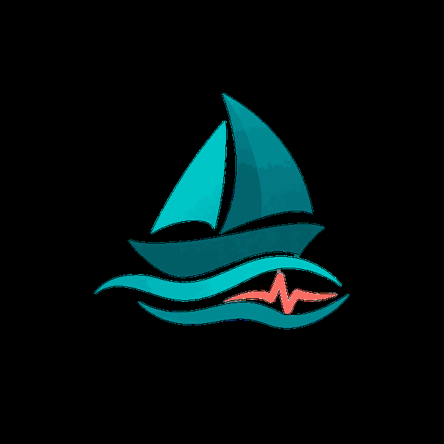
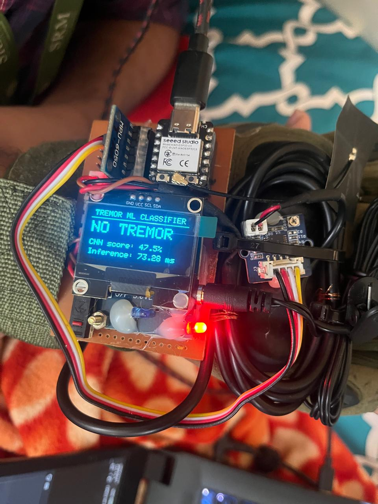
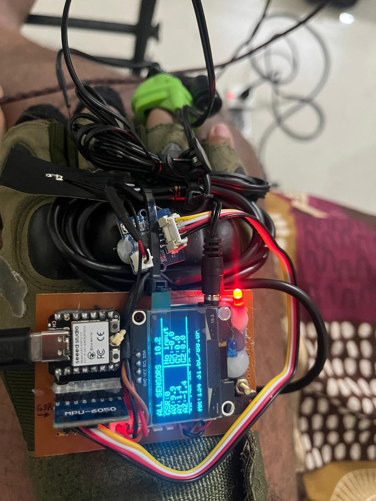
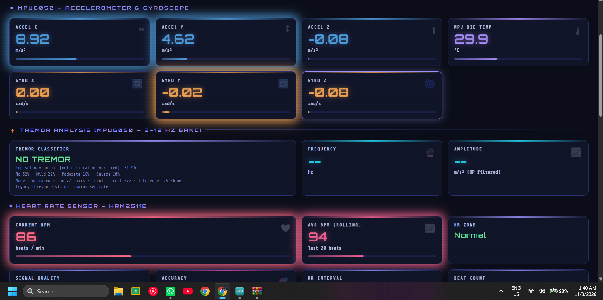
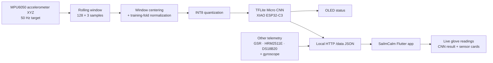
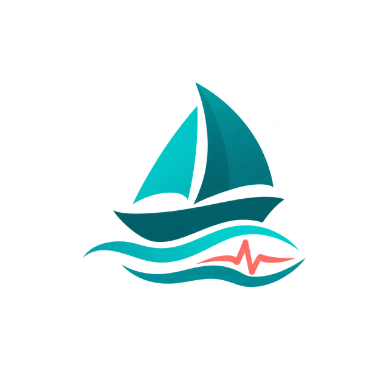

<div align="center">
  <h1>
    
    &nbsp;SailmCalm
  </h1>
  <p><strong>Wearable tremor sensing · On-device edge AI · Companion health app</strong></p>
  <p>
    <a href="Live_demo_Sailcalm.mp4">▶ Watch the live demo</a>
    &nbsp;·&nbsp;
    <a href="https://github.com/seeramyash/Sailcalm/releases/latest/download/SailmCalm-app-release.apk">⬇ Download Android APK</a>
    &nbsp;·&nbsp;
    <a href="JOURNAL_PAPER_HANDOFF.md">Journal paper handoff</a>
  </p>
  <p>
    
    
    
    
  </p>
</div>

---

## Overview

**SailmCalm** is the Android companion application for a wearable sensing glove built around the **Seeed XIAO ESP32-C3**. The glove samples hand movement with an MPU6050 IMU and performs tremor classification locally using a fully quantized **TensorFlow Lite Micro CNN**. SailmCalm reads the device's local JSON endpoint and presents the CNN result together with the glove's sensor telemetry and the app's profile, daily-log, care and reporting features.

The inference model runs on the microcontroller — **the Android application does not run a second copy of the CNN**. Wi-Fi is used to transport readings from the glove to the app on the same local network.

## Demo and downloads

| Resource | Link |
|---|---|
| Live demonstration video | [Live_demo_Sailcalm.mp4](Live_demo_Sailcalm.mp4) |
| Android release APK | [Download the latest APK](https://github.com/seeramyash/Sailcalm/releases/latest/download/SailmCalm-app-release.apk) |
| Source repository | [github.com/seeramyash/Sailcalm](https://github.com/seeramyash/Sailcalm) |
| Technical / journal-paper handoff | [JOURNAL_PAPER_HANDOFF.md](JOURNAL_PAPER_HANDOFF.md) |

> **APK release note:** the direct APK button points to the latest GitHub Release. Publish a release and attach the build as `SailmCalm-app-release.apk` for this link to work. The APK is intentionally not committed to normal Git history because it is a large binary; see [GITHUB_PUBLISH.md](GITHUB_PUBLISH.md).

## Hardware gallery

<div align="center">
  <table>
    <tr>
      <td align="center" width="33%">
        
        <br/><sub><strong>On-device CNN</strong><br/>OLED class, model score and inference time</sub>
      </td>
      <td align="center" width="33%">
        
        <br/><sub><strong>Wearable prototype</strong><br/>XIAO ESP32-C3, MPU6050 and sensor wiring</sub>
      </td>
      <td align="center" width="33%">
        
        <br/><sub><strong>Live dashboard</strong><br/>IMU, tremor classifier and HRM telemetry</sub>
      </td>
    </tr>
  </table>
</div>

## System architecture



### Main data path

1. The MPU6050 accelerometer provides X/Y/Z movement data to the XIAO at a 50 Hz target.
2. Firmware maintains a rolling 128-sample, three-channel window (2.56 seconds at 50 Hz).
3. The input is centered per window and normalized using the channel statistics exported with the trained model.
4. The normalized input is quantized and passed to the INT8 CNN through TensorFlow Lite Micro.
5. The XIAO exposes the prediction, four class probabilities, inference timing and sampling diagnostics through `GET /data`.
6. SailmCalm polls the local endpoint and renders the CNN output in the **On-device CNN Result** section of Live Glove Readings.

## On-device CNN

| Property | Deployed configuration |
|---|---|
| Model identifier | `neurosense_cnn_v2_3axis` |
| Runtime | TensorFlow Lite Micro, full-integer INT8 |
| Target | Seeed XIAO ESP32-C3 |
| Input shape | `1 × 128 × 3` (batch × samples × channels) |
| Input channels | Accelerometer X, Y, Z (`m/s²`) |
| Sampling target | 50 Hz |
| Window duration | 2.56 seconds |
| Inference cadence | Rolling window; 25 new samples between predictions |
| Tensor arena | 64 KiB |
| Output classes | No Tremor, Mild, Moderate, Severe |

**Class mapping:** `0 = NO TREMOR`, `1 = MILD`, `2 = MODERATE`, `3 = SEVERE`.

The MPU6050 gyroscope, GSR, HRM2511E and DS18B20 remain available as device telemetry/context. They are **not inputs to this deployed 3-axis CNN**. A six-axis or physiological multimodal model would require newly collected, synchronized and independently labelled training data; it is not part of this release.

### Offline evaluation summary

The supplied CNN training report records the following grouped held-out evaluation for the INT8 model:

| Metric | Value |
|---|---:|
| Accuracy | 83.30% |
| Balanced accuracy | 64.61% |
| Macro precision | 67.86% |
| Macro recall | 64.61% |
| Macro F1 | 65.92% |
| Weighted F1 | 82.80% |

The class-level recall is uneven: approximately 93.94% (No Tremor), 43.94% (Mild), 60.55% (Moderate), and 60.00% (Severe). The reported grouping is by source segment/group identifiers; it is **not evidence of patient-independent validation** unless participant identities are represented in those groups. The dataset is imbalanced, so accuracy alone is not an adequate summary. See the training report and journal handoff before quoting results.

### Example physical-device smoke test

A supplied `/data?compact=1` response from one physical session reported the CNN available, `neurosense_cnn_v2_3axis`, 73.439 ms inference time and 49.2 Hz measured sampling. That snapshot is a **single-session integration check**, not a long-duration performance benchmark. The model score shown by the device is a softmax output, not classification accuracy or clinical confidence.

## Hardware

The current prototype uses the following main components:

- Seeed XIAO ESP32-C3 microcontroller
- MPU6050 accelerometer / gyroscope module (I²C)
- SH1106-compatible OLED display
- HRM2511E heart-rate sensor
- GSR sensor input
- DS18B20 temperature sensor
- Physical screen-selection button and prototype wiring / wearable assembly

## Repository structure

```text
Group19_edge_SailmCalm_final/
├── 01_Firmware/
│   └── StressTrack_XIAO_50Hz_CNN/
│       ├── StressTrack_XIAO_50Hz_CNN.ino
│       ├── cnn_tflm_runtime.h
│       └── tflite_model_data.h
├── 02_MobileApp/
│   └── MobileApp/                  # Flutter Android application source
├── 03_Model_Training/
│   ├── train_cnn_v2_50hz.py
│   ├── requirements-cnn.txt
│   └── README_TRAINING_SOURCE.md
├── 04_Android_Release/             # APK added to GitHub Releases
├── assets/                         # Logo, hardware and dashboard images
├── JOURNAL_PAPER_HANDOFF.md
├── GITHUB_PUBLISH.md
└── README.md
```

## Getting started

### 1. Flash the glove firmware

1. Install Arduino IDE 2.x and the ESP32 board package.
2. Install the libraries used by the sketch: Adafruit GFX, Adafruit SH110X, Adafruit MPU6050, Adafruit Unified Sensor, OneWire, DallasTemperature and the compatible MicroTFLite / TFLite Micro runtime.
3. Open `01_Firmware/StressTrack_XIAO_50Hz_CNN/StressTrack_XIAO_50Hz_CNN.ino`.
4. Keep the `.ino`, `cnn_tflm_runtime.h` and `tflite_model_data.h` files in the same sketch folder.
5. Select **Seeed XIAO ESP32C3**, select the correct serial port, compile and upload.
6. Confirm these boot messages in Serial Monitor at 115200 baud:

```text
STRESSTRACK_CNN_RUNTIME=COMPILED
STRESSTRACK_CNN_MODEL=READY
```

The shared firmware source intentionally contains Wi-Fi credential placeholders. Configure a local SSID/password or use the `StressTrack-Setup` provisioning access point. Do not commit real hotspot passwords.

### 2. Connect to the same local network

- Connect the XIAO to a Wi-Fi network or phone hotspot.
- Connect the Android phone/tablet to the **same** network.
- Read the current IP address from the OLED.
- Verify the endpoint in a browser: `http://<XIAO-IP>/data?compact=1`.
- The JSON should include `current.ml.available: true` and the model fields.

The demonstrated setup used `iotdata` and `172.20.10.2`; DHCP may assign a different address on another network. The current mobile source must point to the active XIAO IP.

### 3. Build the Android app

Install Flutter and Android build tools, then run in PowerShell:

```powershell
cd .\02_MobileApp\MobileApp
flutter pub get
flutter analyze
flutter test
flutter build apk --release
```

The output is `build\app\outputs\flutter-apk\app-release.apk`. Copy it to `04_Android_Release\SailmCalm-app-release.apk` locally, then attach it to a GitHub Release using the exact asset filename so the download link above resolves.

## App capabilities

The Flutter project retains the existing app screens and includes the live-glove CNN result display. The app contains authentication, private profile records, medication reminders, daily symptom logs, care content, reports and export features. The Live Glove Readings page reads the XIAO's local JSON endpoint; the CNN itself remains on the microcontroller.

## Safety, privacy and research limitations

- This is a research / demonstration prototype, **not a medical device** and not a diagnostic or treatment system.
- The CNN output is a model classification score; it is not a validated probability of disease and not a measure of model accuracy.
- Public data segment grouping does not establish patient-independent validation.
- The current deployed classifier uses accelerometer XYZ only. Do not describe it as a six-axis, GSR-fused or multimodal CNN.
- Do not commit real patient information, phone numbers, Wi-Fi passwords, private keys, Firebase service-account files, signing keystores or `.env` secrets.
- Before publishing a public repository, review Firebase security rules and the configuration files included in the Flutter project.

## Documentation

- [Journal-paper technical handoff](JOURNAL_PAPER_HANDOFF.md)
- [CNN training-source notes](03_Model_Training/README_TRAINING_SOURCE.md)
- [GitHub publishing and release steps](GITHUB_PUBLISH.md)

---

<div align="center">
  
  <br/>
  <sub>Group 19 · SailmCalm / NeuroSense Edge Tremor Monitoring</sub>
</div>
